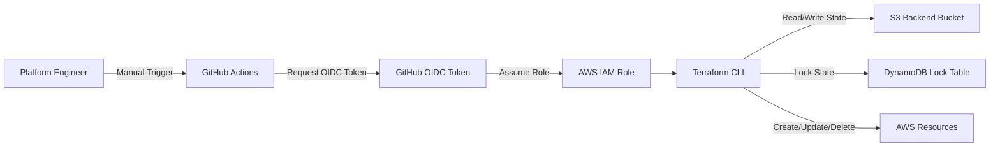
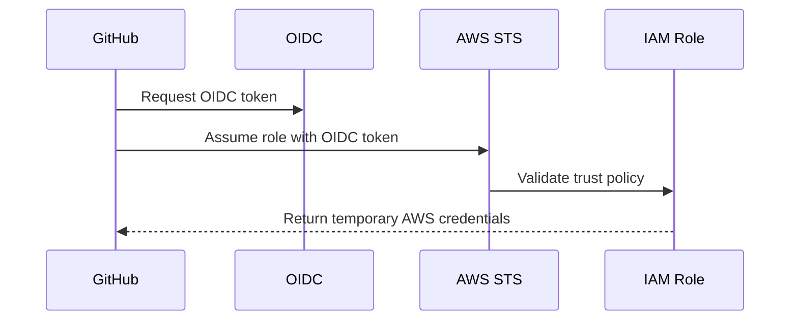
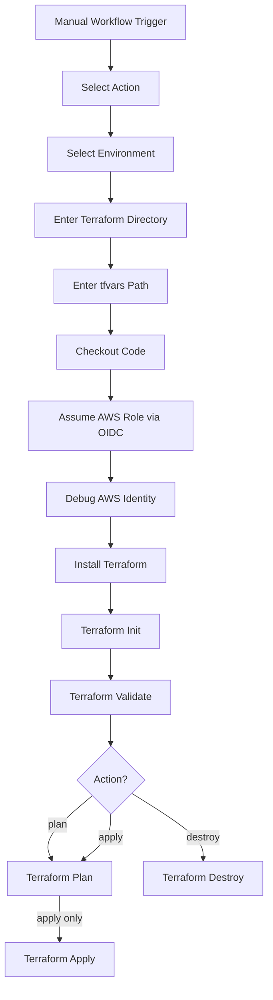

# README: GitHub Actions Terraform Pipeline (`terraform.yml`)

## 1. Purpose of this Pipeline

This `terraform.yml` file is a **GitHub Actions CI/CD pipeline** used to run Terraform commands from GitHub.

It allows a user to manually trigger Terraform actions such as:

- `plan`
- `apply`
- `destroy`

The pipeline is designed for AWS infrastructure deployment and uses:

- GitHub Actions
- Terraform
- AWS OIDC authentication
- S3 remote backend for Terraform state
- DynamoDB for state locking
- Environment-based state file separation

---

## 2. High-Level Pipeline Architecture



---

## 3. Pipeline File

The workflow file is named:

```text
terraform.yml
```

It should normally be placed under:

```text
.github/workflows/terraform.yml
```

---

## 4. Workflow Name

```yaml
name: Terraform CI/CD (AWS)
```

This is the display name shown in the GitHub Actions UI.

When you open the **Actions** tab in GitHub, you will see this workflow as:

```text
Terraform CI/CD (AWS)
```

---

## 5. Trigger Type

```yaml
on:
  workflow_dispatch:
```

This means the pipeline is triggered **manually** from the GitHub UI.

It does not automatically run on:

- push
- pull request
- merge
- schedule

This is useful for infrastructure deployments because Terraform apply/destroy should usually be controlled and intentional.

---

## 6. Manual Input Parameters

The workflow accepts four manual inputs:

```yaml
inputs:
  action:
  environment:
  tf_directory:
  tf_var_file:
```

These inputs control what Terraform should do, where it should run, and which variable file should be used.

---

# 7. Input: `action`

```yaml
action:
  description: "Terraform Action"
  required: true
  default: "plan"
  type: choice
  options: [plan, apply, destroy]
```

## What it means

This input controls which Terraform command should run.

Allowed values:

| Value | Meaning |
|---|---|
| `plan` | Shows what Terraform will create/update/delete |
| `apply` | Applies the planned infrastructure changes |
| `destroy` | Deletes the Terraform-managed infrastructure |

## Example

If you select:

```text
action = plan
```

The pipeline runs:

```bash
terraform plan
```

If you select:

```text
action = apply
```

The pipeline runs:

```bash
terraform plan
terraform apply
```

If you select:

```text
action = destroy
```

The pipeline runs:

```bash
terraform destroy
```

---

# 8. Input: `environment`

```yaml
environment:
  description: "Env to deploy"
  required: true
  default: "dev"
  type: choice
  options: [dev, qa, prod]
```

## What it means

This input tells the pipeline which environment is being deployed.

Supported values:

- `dev`
- `qa`
- `prod`

## Why this is important

The selected environment is used in the Terraform state path:

```yaml
key=state/${{ github.event.inputs.environment }}/${{ github.event.inputs.tf_directory }}/terraform.tfstate
```

So if you choose:

```text
environment = dev
```

and:

```text
tf_directory = aws/services/ec2-1
```

Terraform state will be stored at:

```text
state/dev/aws/services/ec2-1/terraform.tfstate
```

For QA:

```text
state/qa/aws/services/ec2-1/terraform.tfstate
```

For Prod:

```text
state/prod/aws/services/ec2-1/terraform.tfstate
```

This is a good pattern because it prevents different environments from sharing the same state file.

---

# 9. Input: `tf_directory`

```yaml
tf_directory:
  description: "Terraform Working Directory"
  required: true
  default: "aws/services/ec2-1"
```

## What it means

This tells the pipeline where the Terraform code is located.

Example:

```text
aws/services/ec2-1
```

The pipeline uses Terraform's `-chdir` option:

```bash
terraform -chdir=${{ github.event.inputs.tf_directory }} init
```

That means Terraform will run inside the selected service folder.

## Why this is useful

This allows one pipeline to deploy many Terraform services.

Example service folders:

```text
aws/services/ec2-1
aws/services/vpc
aws/services/ecs
aws/services/rds
aws/services/s3
```

Instead of creating one pipeline per service, this single workflow can deploy any folder by changing the `tf_directory` input.

---

# 10. Input: `tf_var_file`

```yaml
tf_var_file:
  description: "Path to tfvars file"
  required: true
  default: "../../../inputvars/dev"
```

## What it means

This tells Terraform which variable file to use.

Terraform variable files usually contain environment-specific values.

Example:

```text
../../../inputvars/dev
```

This is passed to Terraform plan/destroy using:

```bash
-var-file=${{ github.event.inputs.tf_var_file }}
```

## Example `.tfvars` file

```hcl
environment = "dev"
region      = "us-east-2"

instance_name = "dev-web-server"
instance_type = "t3.micro"

vpc_cidr = "10.10.0.0/16"
```

## Important note

The path is relative to the selected `tf_directory` because Terraform runs with `-chdir`.

For example, if Terraform runs from:

```text
aws/services/ec2-1
```

then this path:

```text
../../../inputvars/dev
```

means Terraform looks for:

```text
inputvars/dev
```

from the repository root structure.

---

# 11. Job Definition

```yaml
jobs:
  terraform:
    runs-on: ubuntu-latest
    name: Terraform ${{ github.event.inputs.action }}
```

## What it means

The workflow has one job named:

```text
terraform
```

It runs on:

```text
ubuntu-latest
```

This means GitHub provides a temporary Linux runner to execute the pipeline.

The display name changes based on the selected action.

Examples:

```text
Terraform plan
Terraform apply
Terraform destroy
```

---

# 12. Permissions Block

```yaml
permissions:
  id-token: write
  contents: read
```

## What it means

This is required for GitHub OIDC authentication with AWS.

| Permission | Purpose |
|---|---|
| `id-token: write` | Allows GitHub to request an OIDC token |
| `contents: read` | Allows GitHub Actions to read repository code |

## Why this is important

Without this block, the workflow cannot authenticate securely to AWS using OIDC.

This avoids using long-lived AWS access keys in GitHub secrets.

---

# 13. Environment Variables

```yaml
env:
  AWS_DEFAULT_REGION: us-east-2
```

## What it means

This sets the default AWS region for the pipeline.

In this workflow, the region is:

```text
us-east-2
```

This value is later used in the backend config:

```yaml
-backend-config="region=${{ env.AWS_DEFAULT_REGION }}"
```

---

# 14. Step 1: Checkout Code

```yaml
- name: Checkout code
  uses: actions/checkout@v4
```

## What it does

This downloads the GitHub repository code into the GitHub Actions runner.

Without this step, the pipeline would not have access to:

- Terraform code
- modules
- services
- tfvars files
- provider files

---

# 15. Step 2: Configure AWS Credentials Using OIDC

```yaml
- name: Configure AWS credentials (OIDC)
  uses: aws-actions/configure-aws-credentials@v4
  with:
    role-to-assume: arn:aws:iam::635769555675:role/terraform-assume-role
    aws-region: us-east-2
```

## What it does

This step allows GitHub Actions to authenticate to AWS by assuming an IAM role.

The IAM role used is:

```text
arn:aws:iam::635769555675:role/terraform-assume-role
```

## What happens internally



## Why OIDC is better than static credentials

OIDC is more secure because:

- No AWS access keys are stored in GitHub secrets
- Credentials are temporary
- Role trust can be restricted to specific repo/branch/workflow
- Easier to audit
- Easier to revoke access

---

# 16. Step 3: Debug AWS Identity

```yaml
- name: Debug AWS identity
  run: |
    aws sts get-caller-identity
    aws s3api head-bucket --bucket amvitechawstfinitial
    aws dynamodb describe-table --table-name amviTech_aws_tf
```

## What it does

This step validates that GitHub Actions successfully authenticated to AWS.

It runs three checks.

---

## Check 1: Validate AWS identity

```bash
aws sts get-caller-identity
```

This confirms which AWS role/account the workflow is using.

Expected output includes:

- AWS Account ID
- Assumed role ARN
- User ID

---

## Check 2: Validate S3 backend bucket access

```bash
aws s3api head-bucket --bucket amvitechawstfinitial
```

This confirms the workflow can access the S3 bucket used for Terraform remote state.

S3 bucket:

```text
amvitechawstfinitial
```

---

## Check 3: Validate DynamoDB lock table access

```bash
aws dynamodb describe-table --table-name amviTech_aws_tf
```

This confirms the workflow can access the DynamoDB table used for Terraform state locking.

DynamoDB table:

```text
amviTech_aws_tf
```

---

# 17. Step 4: Setup Terraform

```yaml
- name: Setup Terraform
  uses: hashicorp/setup-terraform@v3
  with:
    terraform_version: 1.5.7
```

## What it does

This installs Terraform version:

```text
1.5.7
```

on the GitHub Actions runner.

This ensures consistent Terraform behavior across all pipeline runs.

---

# 18. Step 5: Terraform Init

```yaml
- name: Terraform Init
  run: |
    terraform -chdir=${{ github.event.inputs.tf_directory }} init \
      -backend-config="bucket=amvitechawstfinitial" \
      -backend-config="key=state/${{ github.event.inputs.environment }}/${{ github.event.inputs.tf_directory }}/terraform.tfstate" \
      -backend-config="region=${{ env.AWS_DEFAULT_REGION }}" \
      -backend-config="dynamodb_table=amviTech_aws_tf" \
      -backend-config="encrypt=true"
```

## What it does

`terraform init` initializes Terraform in the selected service folder.

It prepares Terraform by:

- Downloading providers
- Downloading modules
- Configuring backend
- Connecting to remote state
- Enabling state locking

---

## Important parts

### Working directory

```bash
-chdir=${{ github.event.inputs.tf_directory }}
```

This runs Terraform inside the folder selected during manual execution.

Example:

```text
aws/services/ec2-1
```

---

### Backend bucket

```bash
-backend-config="bucket=amvitechawstfinitial"
```

Terraform state is stored in this S3 bucket.

---

### State key

```bash
-backend-config="key=state/${{ github.event.inputs.environment }}/${{ github.event.inputs.tf_directory }}/terraform.tfstate"
```

This dynamically creates a state path based on environment and service folder.

Example:

```text
state/dev/aws/services/ec2-1/terraform.tfstate
```

This prevents state conflicts between environments and services.

---

### Backend region

```bash
-backend-config="region=${{ env.AWS_DEFAULT_REGION }}"
```

Uses the region defined in the workflow environment variable.

---

### DynamoDB state locking

```bash
-backend-config="dynamodb_table=amviTech_aws_tf"
```

This table prevents multiple Terraform runs from modifying the same state file at the same time.

---

### State encryption

```bash
-backend-config="encrypt=true"
```

Enables encryption for Terraform state stored in S3.

---

# 19. Step 6: Terraform Validate

```yaml
- name: Terraform Validate
  run: terraform -chdir=${{ github.event.inputs.tf_directory }} validate
```

## What it does

This checks whether Terraform files are syntactically valid.

It validates:

- Resource syntax
- Variable references
- Provider configuration
- Module structure

It does not create or change infrastructure.

---

# 20. Step 7: Terraform Plan

```yaml
- name: Terraform Plan
  if: ${{ github.event.inputs.action == 'plan' || github.event.inputs.action == 'apply' }}
  run: |
    terraform -chdir=${{ github.event.inputs.tf_directory }} plan \
      -var-file=${{ github.event.inputs.tf_var_file }} \
      -out=tfplan
```

## What it does

Terraform plan calculates the infrastructure changes.

It shows what Terraform will:

- Create
- Update
- Replace
- Destroy

The plan runs only when action is:

- `plan`
- `apply`

It does not run for:

- `destroy`

---

## Variable file

```bash
-var-file=${{ github.event.inputs.tf_var_file }}
```

This loads environment-specific values.

Example:

```bash
-var-file=../../../inputvars/dev
```

---

## Plan output file

```bash
-out=tfplan
```

This saves the plan to a file named:

```text
tfplan
```

The apply step uses this exact plan file.

This is good because Terraform applies the same changes that were planned.

---

# 21. Step 8: Terraform Apply

```yaml
- name: Terraform Apply
  if: ${{ github.event.inputs.action == 'apply' }}
  run: terraform -chdir=${{ github.event.inputs.tf_directory }} apply -auto-approve tfplan
```

## What it does

This applies the Terraform plan.

It runs only when action is:

```text
apply
```

It executes:

```bash
terraform apply -auto-approve tfplan
```

## Why `tfplan` is used

The apply command uses the saved plan file from the previous step.

This ensures that Terraform applies the same changes that were reviewed during the plan step.

---

## What `-auto-approve` means

```bash
-auto-approve
```

means Terraform will not ask for manual confirmation in the terminal.

This is required in CI/CD because GitHub Actions cannot interactively type `yes`.

For production, it is better to use GitHub environment approvals before this step.

---

# 22. Step 9: Terraform Destroy

```yaml
- name: Terraform Destroy
  if: ${{ github.event.inputs.action == 'destroy' }}
  run: |
    terraform -chdir=${{ github.event.inputs.tf_directory }} destroy \
      -auto-approve \
      -var-file=${{ github.event.inputs.tf_var_file }}
```

## What it does

This deletes Terraform-managed infrastructure.

It runs only when action is:

```text
destroy
```

## Important warning

Destroy is dangerous because it can delete real infrastructure.

For production, you should protect this with:

- GitHub environment approval
- Branch restrictions
- Manual approval gates
- IAM policy restrictions
- Separate production role

---

# 23. Complete Pipeline Flow



---

# 24. Example: Run Plan for Dev

## GitHub UI Inputs

```text
action       = plan
environment  = dev
tf_directory = aws/services/ec2-1
tf_var_file  = ../../../inputvars/dev
```

## What happens

Terraform runs:

```bash
terraform init
terraform validate
terraform plan -var-file=../../../inputvars/dev -out=tfplan
```

State file location:

```text
s3://amvitechawstfinitial/state/dev/aws/services/ec2-1/terraform.tfstate
```

---

# 25. Example: Run Apply for QA

## GitHub UI Inputs

```text
action       = apply
environment  = qa
tf_directory = aws/services/ec2-1
tf_var_file  = ../../../inputvars/qa
```

## What happens

Terraform runs:

```bash
terraform init
terraform validate
terraform plan -var-file=../../../inputvars/qa -out=tfplan
terraform apply -auto-approve tfplan
```

State file location:

```text
s3://amvitechawstfinitial/state/qa/aws/services/ec2-1/terraform.tfstate
```

---

# 26. Example: Run Destroy for Dev

## GitHub UI Inputs

```text
action       = destroy
environment  = dev
tf_directory = aws/services/ec2-1
tf_var_file  = ../../../inputvars/dev
```

## What happens

Terraform runs:

```bash
terraform init
terraform validate
terraform destroy -auto-approve -var-file=../../../inputvars/dev
```

---

# 27. Security Model

## Current Security Strengths

This pipeline follows several good security practices.

### 1. OIDC Authentication

The pipeline uses:

```yaml
aws-actions/configure-aws-credentials@v4
```

with:

```yaml
role-to-assume
```

This avoids storing AWS access keys in GitHub secrets.

---

### 2. Minimum GitHub Permissions

```yaml
permissions:
  id-token: write
  contents: read
```

This is better than giving broad GitHub permissions.

---

### 3. Remote Backend

Terraform state is stored in S3, not locally.

This supports:

- Collaboration
- Centralized state management
- State recovery
- Auditability

---

### 4. DynamoDB Locking

DynamoDB prevents multiple users/pipelines from changing the same Terraform state at once.

---

### 5. Encrypted State

```yaml
encrypt=true
```

Terraform state is encrypted at rest in S3.

---

# 28. Recommended Production Improvements

## 1. Use GitHub Environments

For production, configure GitHub environments:

```yaml
environment: ${{ github.event.inputs.environment }}
```

Then configure required reviewers in GitHub.

This adds approval before apply/destroy.

---

## 2. Restrict Apply and Destroy

Do not allow everyone to run `apply` or `destroy`.

Recommended:

- Developers can run `plan`
- Platform engineers can run `apply`
- Only admins can run `destroy`

---

## 3. Add Terraform Format Check

Add:

```bash
terraform fmt -check -recursive
```

This ensures consistent Terraform formatting.

---

## 4. Add Security Scanning

Recommended tools:

- Checkov
- tfsec
- Terrascan
- Trivy

Example:

```bash
checkov -d .
```

---

## 5. Remove or Limit Debug Step in Production

The debug step is useful during setup:

```bash
aws sts get-caller-identity
aws s3api head-bucket
aws dynamodb describe-table
```

But in mature production workflows, keep only what is necessary.

---

## 6. Separate AWS Roles by Environment

Recommended role pattern:

```text
terraform-dev-role
terraform-qa-role
terraform-prod-role
```

This gives stronger isolation.

---

## 7. Restrict OIDC Trust Policy

The AWS IAM role trust policy should restrict access to:

- Specific GitHub organization
- Specific repository
- Specific branch
- Specific workflow

Example condition pattern:

```json
"Condition": {
  "StringEquals": {
    "token.actions.githubusercontent.com:aud": "sts.amazonaws.com"
  },
  "StringLike": {
    "token.actions.githubusercontent.com:sub": "repo:vijayw19/amviTech_terraform_modules:*"
  }
}
```

---

# 29. Common Issues and Fixes

## Issue 1: Access Denied to S3 Backend

### Error

```text
AccessDenied: Access Denied
```

### Cause

The IAM role does not have access to the backend bucket.

### Fix

Grant permissions:

```json
s3:GetObject
s3:PutObject
s3:DeleteObject
s3:ListBucket
```

---

## Issue 2: DynamoDB Lock Error

### Error

```text
Error acquiring the state lock
```

### Cause

Another Terraform run is active, or a stale lock exists.

### Fix

Check the DynamoDB lock table and confirm whether the lock is stale before removing it.

---

## Issue 3: Wrong tfvars Path

### Error

```text
Failed to read variables file
```

### Cause

`tf_var_file` path is incorrect relative to `tf_directory`.

### Fix

Verify the relative path from the service folder.

Example:

```text
../../../inputvars/dev
```

---

## Issue 4: Wrong State File Used

### Cause

Incorrect environment selection.

Example:

```text
environment = prod
```

but:

```text
tf_var_file = ../../../inputvars/dev
```

### Fix

Make sure environment and tfvars file match.

Recommended:

```text
environment = dev
tf_var_file = ../../../inputvars/dev
```

---

# 30. Best Practice Execution Strategy

## For Dev

```text
plan -> apply
```

Dev can be more flexible.

---

## For QA

```text
plan -> review -> apply
```

QA should have some review.

---

## For Prod

```text
plan -> approval -> apply
```

Prod must have approval gates.

Destroy should be restricted.

---

# 31. Summary

This `terraform.yml` GitHub Actions workflow provides a reusable Terraform deployment pipeline for AWS infrastructure.

It supports:

- Manual Terraform execution
- Environment-specific deployments
- Service-folder-based deployment
- S3 remote backend
- DynamoDB state locking
- OIDC-based secure AWS authentication
- Plan/apply/destroy workflows

The strongest part of this pipeline is the move from static AWS credentials to GitHub OIDC-based role assumption.

For production readiness, the main recommended improvements are:

- Add GitHub environment approvals
- Restrict production apply/destroy
- Add Terraform formatting and security scanning
- Use separate AWS roles per environment
- Strengthen OIDC trust policy conditions
